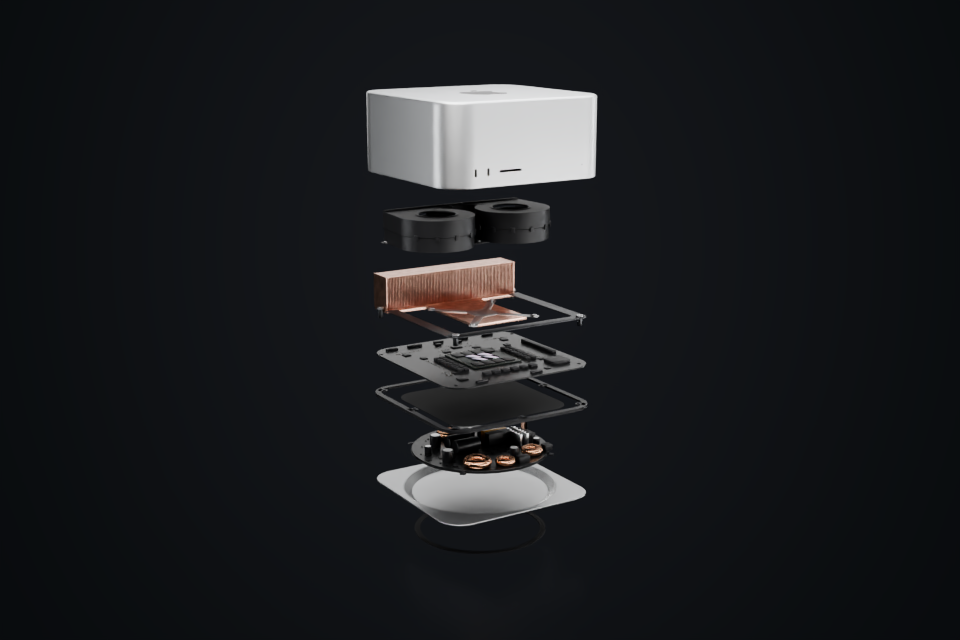
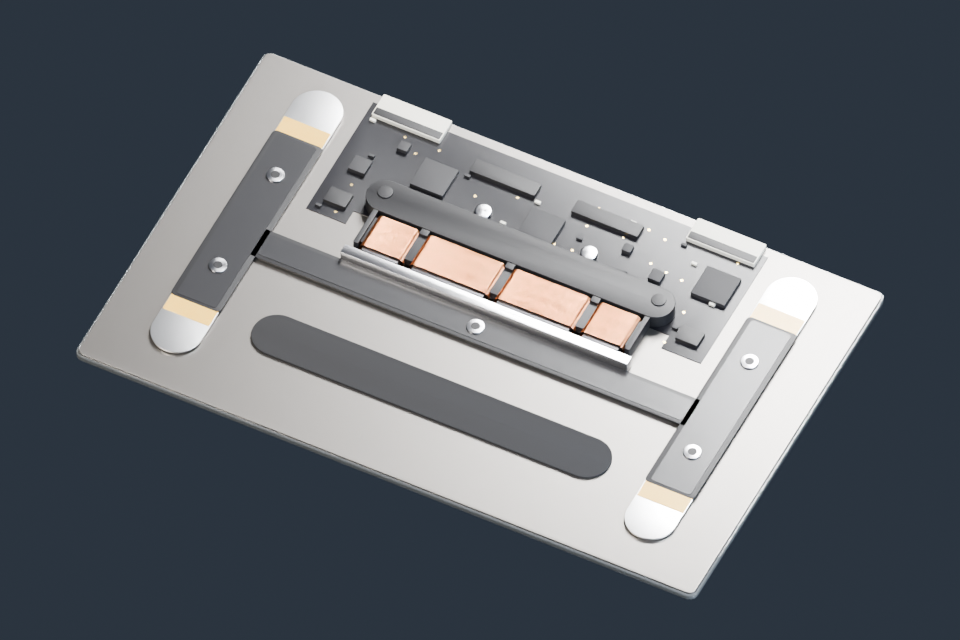
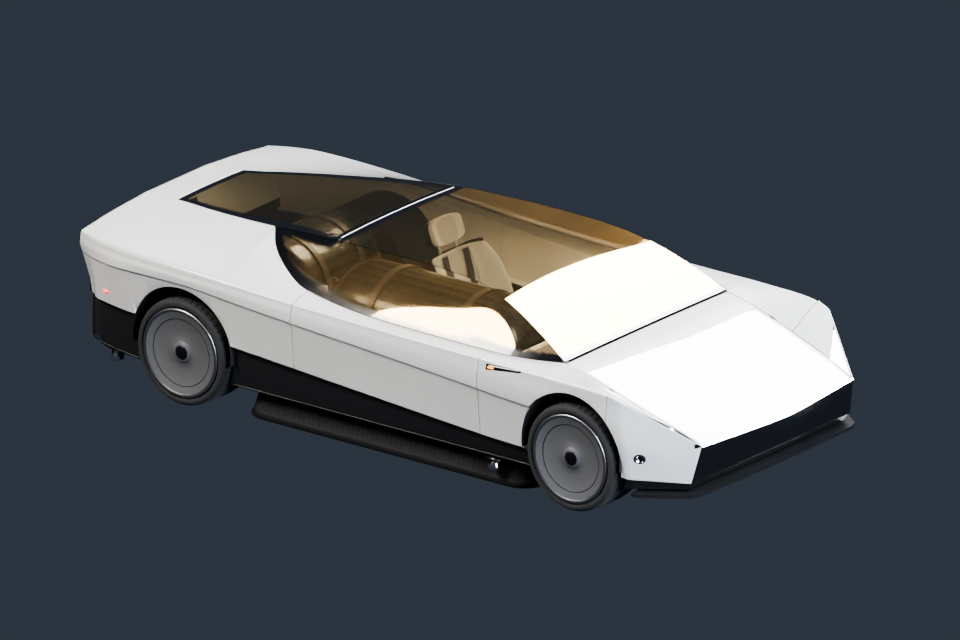
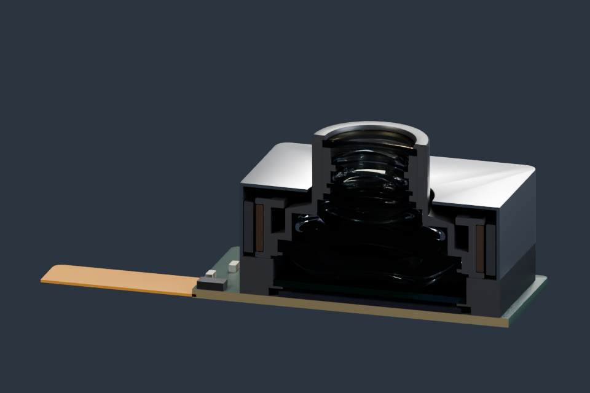
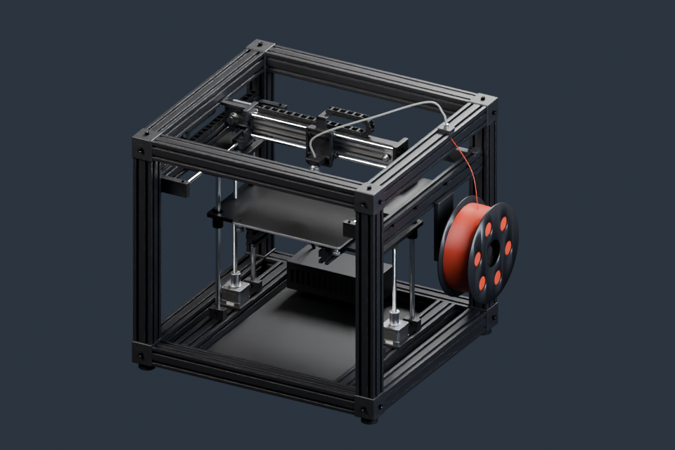

# 视频建模素材库

把视频中制作的模型交给创作者继续使用：改材质、换镜头、拆零件，制作你自己的视频。

**五组 Blender 模型已发布。** 下载对应主题的 ZIP，解压后打开 start.blend。测试版本：Blender 5.1.2。

| 预览 | 素材与使用说明 | 模型下载 |
| --- | --- | --- |
|  | [Mac Studio](models/mac-studio/README.md) | [下载 v1.0.0](https://github.com/boomyao/video-model-library/releases/download/mac-studio-v1.0.0/mac-studio-v1.0.0-blender.zip) · 23.82 MiB |
|  | [ForceTouch](models/force-touch/README.md) | [下载 v1.0.0](https://github.com/boomyao/video-model-library/releases/download/force-touch-v1.0.0/force-touch-v1.0.0-blender.zip) · 0.97 MiB |
|  | [Roadster](models/roadster/README.md) | [下载 v1.0.0](https://github.com/boomyao/video-model-library/releases/download/roadster-v1.0.0/roadster-v1.0.0-blender.zip) · 2.85 MiB |
|  | [手机摄像头与光学](models/camera-optics/README.md) | [下载 v1.0.0](https://github.com/boomyao/video-model-library/releases/download/camera-optics-v1.0.0/camera-optics-v1.0.0-blender.zip) · 8.69 MiB |
|  | [3D 打印机与运动机构](models/3d-printer/README.md) | [下载 v1.0.0](https://github.com/boomyao/video-model-library/releases/download/3d-printer-v1.0.0/3d-printer-v1.0.0-blender.zip) · 19.01 MiB |

## 直接使用

每个包包含模型、程序化材质、基础灯光与摄影机、说明和许可；不需要 Git 或 Python。选择 ASSET 集合可导入自己的项目。
Mac Studio 提供完整、拆解和剖切；摄像头提供模组、手机和光线；打印机提供整机、机构和电机剖面。ForceTouch 包含短按压关键帧演示，其余以静态模型为主。

**绿色 Code → Download ZIP 与 Release 自动生成的 Source code 文件是源码。模型请点击上表“下载”。**

## 学习或修改建模

源码在 models/各主题/src/；每组 build.py 是独立入口，共用 tools/release_scene.py 整理场景与预览。从仓库根目录运行对应主题说明中的命令。
大模型文件保存在 Releases，Git 只存建模源码、必要小数据和轻量预览。每组独立发版。

## 许可和署名

原创模型、程序化材质及预览图：**CC BY 4.0**。原创建模代码和文档：**MIT**。允许在遵守相应许可的情况下修改、商业使用和再分发。
第三方标志、来源数据和其他例外见各主题 SOURCES.md；这些模型是视频可视化素材，不是官方 CAD 或制造图纸。

署名示例：模型：boomyao / video-model-library，https://github.com/boomyao/video-model-library，CC BY 4.0；修改：注明你的修改。

[使用说明](docs/quick-start.md) · [许可详情](licenses/README.md) · [贡献与反馈](docs/contributing.md) · [发布方式](docs/publishing.md)
