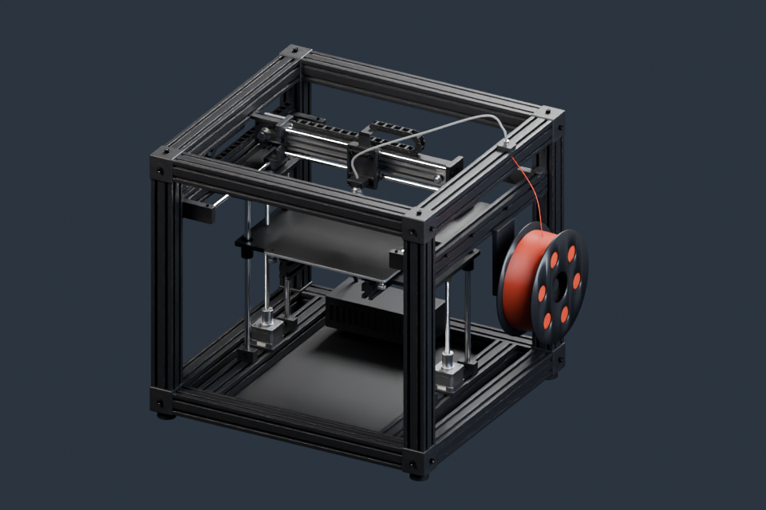

# 3D 打印机与运动机构



通用打印机整机、喷头、打印床、皮带传动、拖链、料盘和步进电机剖面；各部分可以拆出复用。

**[下载 Blender 模型包 · v1.0.0 · 19.01 MiB](https://github.com/boomyao/video-model-library/releases/download/3d-printer-v1.0.0/3d-printer-v1.0.0-blender.zip)** · [版本说明](https://github.com/boomyao/video-model-library/releases/tag/3d-printer-v1.0.0)

测试版本：**Blender 5.1.2**；其他版本未测试。解压整个文件夹后打开 start.blend，无需 Git 或 Python。

| 文件 | 内容 |
| --- | --- |
| start.blend | 打印机整机 |
| gantry.blend | 横梁、喷头与传动机构 |
| stepper-cutaway.blend | 步进电机剖切 |

start.blend 为整机，gantry.blend 为运动机构，stepper-cutaway.blend 为电机剖面。单位为毫米（1 Blender 单位 = 1 mm）；与其他包合并时保留或正确换算单位。源码整机.整机().pose(x=...,y=...,z=...) 控制喷头姿态；动画需对相关物体写入关键帧或从脚本逐帧生成。

ASSET 集合包含模型，STUDIO 包含摄影机与灯光。跨项目使用可通过 File → Append 导入 ASSET 集合。

## 源码与复现

建模入口：[src/build.py](src/build.py)。从仓库根目录运行：

```sh
blender -b --factory-startup --disable-autoexec --python models/3d-printer/src/build.py -- --out build/3d-printer --render
```

Blender 自带 bpy 与 NumPy。`--render` 可省略以只生成模型；输出目录由你指定。代码依赖仓库 tools/release_scene.py，请保留整个仓库的目录层级。

本版本已从独立目录重新打开并检查模型、材质依赖、集合导入；预览为实际 Blender 渲染。

## 范围与许可

用于视频讲解的可视化模型，不是可直接制造、安装或打印的工程图纸。此版不带完整视频运动及切片工具路径。

原创模型和材质：CC BY 4.0；原创代码：MIT。[来源和第三方例外](SOURCES.md) · [完整许可](../../licenses/README.md)。

建议署名：模型：boomyao / video-model-library，https://github.com/boomyao/video-model-library，CC BY 4.0；修改：注明你的修改。

[返回全部素材](../../README.md)
