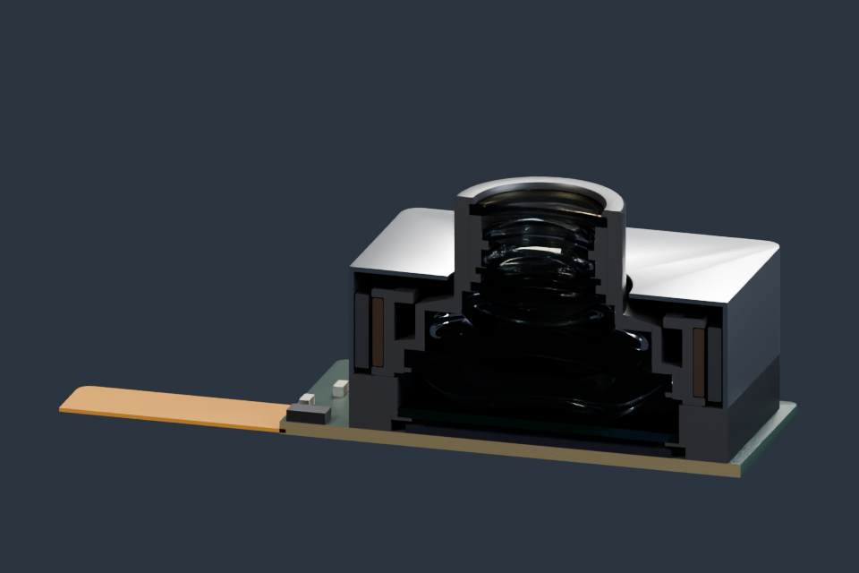

# 手机摄像头与光学



八片镜片、摄像头模组、传感器、手机外形，以及计算得到的光线路径；完整和剖切版本分别提供。

**[下载 Blender 模型包 · v1.0.0 · 8.69 MiB](https://github.com/boomyao/video-model-library/releases/download/camera-optics-v1.0.0/camera-optics-v1.0.0-blender.zip)** · [版本说明](https://github.com/boomyao/video-model-library/releases/tag/camera-optics-v1.0.0)

测试版本：**Blender 5.1.2**；其他版本未测试。解压整个文件夹后打开 start.blend，无需 Git 或 Python。

| 文件 | 内容 |
| --- | --- |
| start.blend | 完整摄像头模组 |
| cutaway.blend | 模组剖切 |
| phone.blend | 手机外形与摄像头 |
| lens-rays.blend | 镜片剖面与光线路径 |

start.blend 为完整模组；cutaway.blend 看内部结构；phone.blend 为手机外形；lens-rays.blend 查看镜片与光线。源码 Module.focus(mm) 与 Module.shift(x_mm,y_mm) 可控制对焦及平移，本版场景保持静态，不依赖逐帧回调。

ASSET 集合包含模型，STUDIO 包含摄影机与灯光。跨项目使用可通过 File → Append 导入 ASSET 集合。

## 源码与复现

建模入口：[src/build.py](src/build.py)。从仓库根目录运行：

```sh
blender -b --factory-startup --disable-autoexec --python models/camera-optics/src/build.py -- --out build/camera-optics --render
```

Blender 自带 bpy 与 NumPy。`--render` 可省略以只生成模型；输出目录由你指定。代码依赖仓库 tools/release_scene.py，请保留整个仓库的目录层级。

本版本已从独立目录重新打开并检查模型、材质依赖、集合导入；预览为实际 Blender 渲染。

## 范围与许可

镜片来自专利第 1 实施例；其余模组、马达和手机包括示意几何。光线为计算路径的可视化，不是完整波动光学仿真，也不是制造图纸。

原创模型和材质：CC BY 4.0；原创代码：MIT。[来源和第三方例外](SOURCES.md) · [完整许可](../../licenses/README.md)。

建议署名：模型：boomyao / video-model-library，https://github.com/boomyao/video-model-library，CC BY 4.0；修改：注明你的修改。

[返回全部素材](../../README.md)
