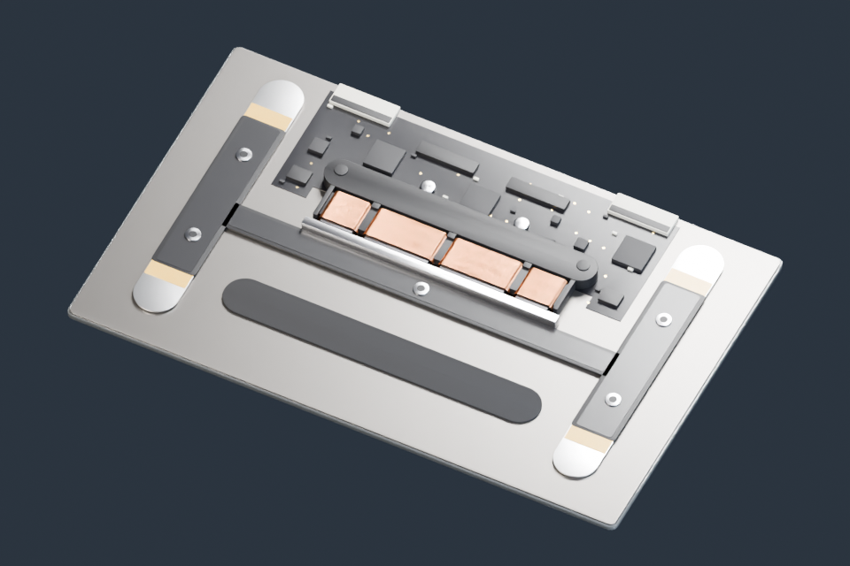

# ForceTouch



玻璃触控板、支架、弹片、应变片、线圈与磁性结构；附一段可直接播放的按压关键帧演示。

**[下载 Blender 模型包 · v1.0.0 · 0.97 MiB](https://github.com/boomyao/video-model-library/releases/download/force-touch-v1.0.0/force-touch-v1.0.0-blender.zip)** · [版本说明](https://github.com/boomyao/video-model-library/releases/tag/force-touch-v1.0.0)

测试版本：**Blender 5.1.2**；其他版本未测试。解压整个文件夹后打开 start.blend，无需 Git 或 Python。

| 文件 | 内容 |
| --- | --- |
| start.blend | 触控板模组及按压关键帧 |

打开 start.blend，时间线为 1–48 帧、24 fps。按空格播放，模组在第 15 帧发生位移，第 20 帧回到原位。该动画用于观察动作，不代表真实震动时序。源码 module.build_module(gap=0.3, floor=False) 可单独生成主体。

ASSET 集合包含模型，STUDIO 包含摄影机与灯光。跨项目使用可通过 File → Append 导入 ASSET 集合。

## 源码与复现

建模入口：[src/build.py](src/build.py)。从仓库根目录运行：

```sh
blender -b --factory-startup --disable-autoexec --python models/force-touch/src/build.py -- --out build/force-touch --render
```

Blender 自带 bpy 与 NumPy。`--render` 可省略以只生成模型；输出目录由你指定。代码依赖仓库 tools/release_scene.py，请保留整个仓库的目录层级。

本版本已从独立目录重新打开并检查模型、材质依赖、集合导入；预览为实际 Blender 渲染。

## 范围与许可

第一版只包含触控板主体，不包含手部网格、手指贴图、桌面和原片剪辑。实际气隙及结构部分按原工程的说明作示意。

原创模型和材质：CC BY 4.0；原创代码：MIT。[来源和第三方例外](SOURCES.md) · [完整许可](../../licenses/README.md)。

建议署名：模型：boomyao / video-model-library，https://github.com/boomyao/video-model-library，CC BY 4.0；修改：注明你的修改。

[返回全部素材](../../README.md)
