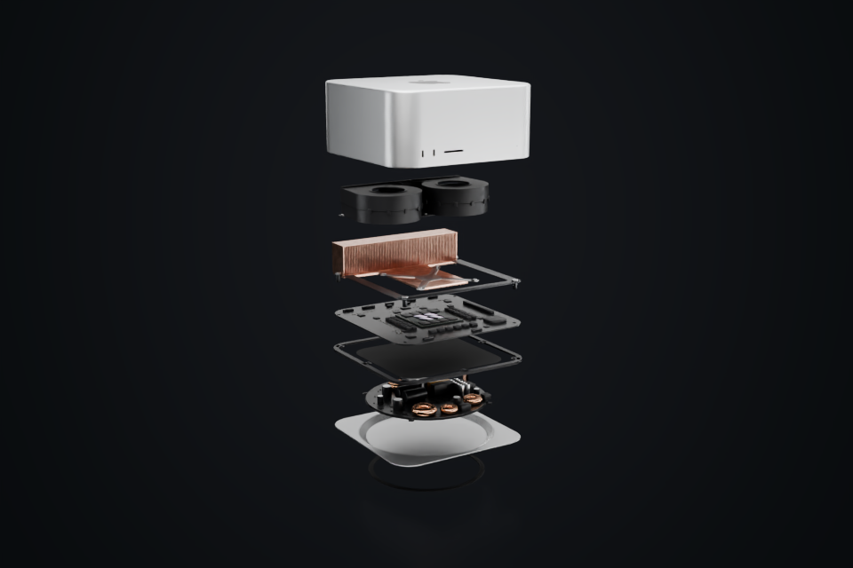

# Mac Studio



主机外壳、底座、电源、主板、芯片、散热器、双风扇与内部结构；包含完整、拆解和剖切三种状态。

**[下载 Blender 模型包 · v1.0.0 · 23.82 MiB](https://github.com/boomyao/video-model-library/releases/download/mac-studio-v1.0.0/mac-studio-v1.0.0-blender.zip)** · [版本说明](https://github.com/boomyao/video-model-library/releases/tag/mac-studio-v1.0.0)

测试版本：**Blender 5.1.2**；其他版本未测试。解压整个文件夹后打开 start.blend，无需 Git 或 Python。

| 文件 | 内容 |
| --- | --- |
| start.blend | 完整装配 |
| exploded.blend | 爆炸拆解 |
| cutaway.blend | 剖切结构 |

start.blend 是装配状态。exploded.blend 可直接查看内部层次，cutaway.blend 可查看剖面。EXPLODE_CTRL 的 explode 自定义属性控制展开程度；保持所有依赖集合一同导入。Max/Ultra 变体和展示用集合默认隐藏，请按需启用。

ASSET 集合包含模型，STUDIO 包含摄影机与灯光。跨项目使用可通过 File → Append 导入 ASSET 集合。

## 源码与复现

建模入口：[src/build.py](src/build.py)。从仓库根目录运行：

```sh
blender -b --factory-startup --disable-autoexec --python models/mac-studio/src/build.py -- --out build/mac-studio --render
```

Blender 自带 bpy 与 NumPy。`--render` 可省略以只生成模型；输出目录由你指定。代码依赖仓库 tools/release_scene.py，请保留整个仓库的目录层级。

本版本已从独立目录重新打开并检查模型、材质依赖、集合导入；预览为实际 Blender 渲染。

## 范围与许可

视频结构重建，部分内部结构和芯片细节为示意，不是官方 CAD 或实物测量文件。M5 命名沿用视频工程，不代表模型与任何实际上市产品完全一致。

原创模型和材质：CC BY 4.0；原创代码：MIT。[来源和第三方例外](SOURCES.md) · [完整许可](../../licenses/README.md)。

建议署名：模型：boomyao / video-model-library，https://github.com/boomyao/video-model-library，CC BY 4.0；修改：注明你的修改。

[返回全部素材](../../README.md)
