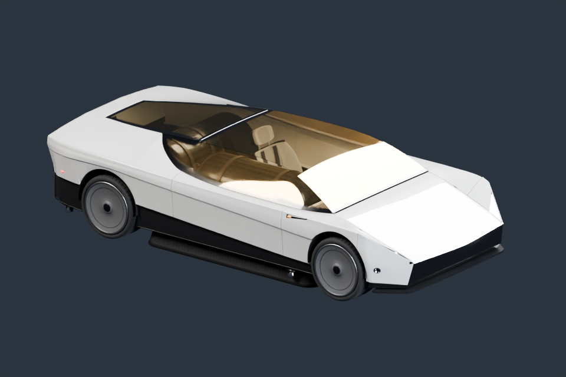

# Roadster



从原工程较新的 car2.py 重建的车辆：外壳、车轮、内饰、底盘、气瓶、管路及喷嘴结构。

**[下载 Blender 模型包 · v1.0.0 · 2.85 MiB](https://github.com/boomyao/video-model-library/releases/download/roadster-v1.0.0/roadster-v1.0.0-blender.zip)** · [版本说明](https://github.com/boomyao/video-model-library/releases/tag/roadster-v1.0.0)

测试版本：**Blender 5.1.2**；其他版本未测试。解压整个文件夹后打开 start.blend，无需 Git 或 Python。

| 文件 | 内容 |
| --- | --- |
| start.blend | 车辆与内部结构 |

打开 start.blend。ASSET/Vehicle 内保留独立零件和原始命名，可隐藏车身面板查看内饰及结构。修改材质可在源码 car_mats.py 中进行；build.py 生成静态可编辑车辆。

ASSET 集合包含模型，STUDIO 包含摄影机与灯光。跨项目使用可通过 File → Append 导入 ASSET 集合。

## 源码与复现

建模入口：[src/build.py](src/build.py)。从仓库根目录运行：

```sh
blender -b --factory-startup --disable-autoexec --python models/roadster/src/build.py -- --out build/roadster --render
```

Blender 自带 bpy 与 NumPy。`--render` 可省略以只生成模型；输出目录由你指定。代码依赖仓库 tools/release_scene.py，请保留整个仓库的目录层级。

本版本已从独立目录重新打开并检查模型、材质依赖、集合导入；预览为实际 Blender 渲染。

## 范围与许可

视频中的概念及特技示意车辆，不是官方生产 CAD。此版不含原片赛道、烟雾、喷气模拟缓存或完整驾驶动画。

原创模型和材质：CC BY 4.0；原创代码：MIT。[来源和第三方例外](SOURCES.md) · [完整许可](../../licenses/README.md)。

建议署名：模型：boomyao / video-model-library，https://github.com/boomyao/video-model-library，CC BY 4.0；修改：注明你的修改。

[返回全部素材](../../README.md)
